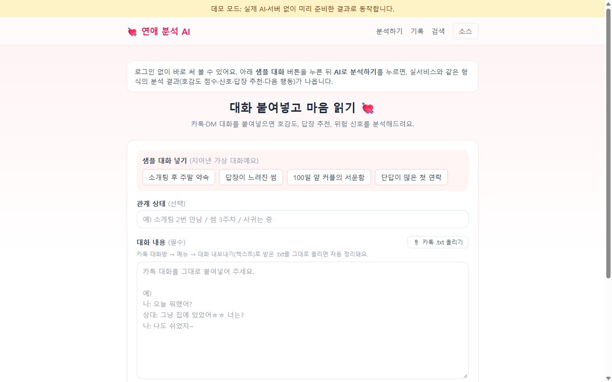
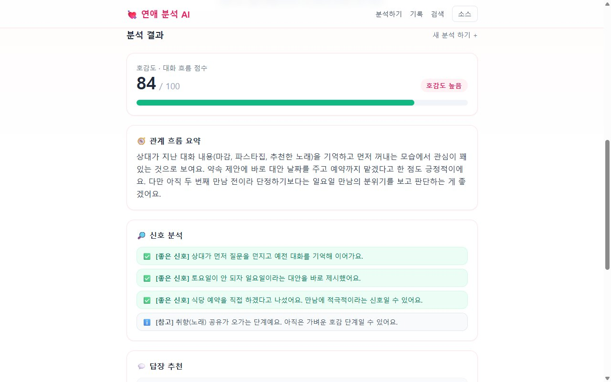

# 연애 대화 분석 AI

> 🔗 **Live Demo**: https://yeonae-ai.vercel.app

카카오톡·DM 대화를 붙여 넣으면 상대의 호감도, 좋은 신호와 위험 신호, 보낼 만한 답장, 다음에 할 행동을 정리해 주는 웹 서비스입니다.

**[바로 써 보기 (데모, 로그인 필요 없음)](https://yeomhojun1.github.io/yeonae-ai/)**

---

## 이게 뭔가요

썸을 타거나 소개팅을 한 뒤, 상대와 나눈 대화를 친구에게 보여 주며 "이 사람 나한테 관심 있는 것 같아?"라고 묻는 경우가 많습니다. 이 서비스는 그 친구 역할을 AI가 맡습니다. 대화를 넣으면 AI가 읽고 호감도 점수와 근거, 답장 예시를 정리해 줍니다.

여기에 더해, 지금까지 분석한 대화 기록을 "서운했던 순간"처럼 **말뜻으로 다시 찾아보는 검색**도 만들었습니다.

## 이런 분께 필요해요

- 소개팅 뒤 연락을 주고받는데, 상대 답장이 예의상인지 관심인지 헷갈리는 사람
- 썸이 한 달째인데 답장이 점점 느려져서, 지금 어떻게 답해야 할지 고민하는 사람
- 연애 중인데 서운했던 일을 꺼내기 전에, 예전 대화를 다시 살펴보고 싶은 사람

## 화면으로 보기

**1. 입력 화면** — 대화를 붙여 넣거나, 카카오톡에서 내보낸 .txt 파일을 올립니다. 데모에서는 위쪽의 샘플 대화 버튼으로 바로 채울 수 있습니다.



**2. 결과 화면** — 호감도 점수(0~100), 관계 흐름 요약, 좋은 신호와 참고 사항이 나옵니다. 아래로 내리면 답장 추천과 다음 행동이 이어집니다.



## 바로 써 보기

**[https://yeomhojun1.github.io/yeonae-ai/](https://yeomhojun1.github.io/yeonae-ai/)**

설치나 회원가입, 로그인 없이 브라우저에서 바로 열립니다.

1. 첫 화면의 **샘플 대화** 버튼 4개(소개팅 후 주말 약속 / 답장이 느려진 썸 / 100일 앞 커플의 서운함 / 단답이 많은 첫 연락) 중 하나를 누릅니다.
2. **AI로 분석하기**를 누르면 결과 화면이 나옵니다.
3. 위쪽 메뉴의 **기록**에서 샘플 4개가 저장된 기록처럼 보이는 것을 확인할 수 있습니다.
4. 위쪽 메뉴의 **검색**에서 예시 검색어(예: "서운했던 순간", "읽씹당한 패턴")를 눌러 뜻으로 찾는 검색을 체험합니다.

알아 두실 점:

- 데모는 실제 AI나 서버 없이 동작합니다. 샘플 대화 4개는 지어낸 대화이고, 분석 결과는 실제 서비스와 같은 형식에 맞춰 미리 준비해 둔 것입니다.
- 그래서 직접 붙여 넣은 대화는 데모에서 분석되지 않고, 검색도 준비된 예시 검색어 5개만 됩니다.
- 데모의 검색 결과는 실제 서비스와 같은 검색 모델로 샘플 대화를 미리 검색해 저장해 둔 값입니다.

## 할 수 있는 것

- 대화를 넣으면 상대의 관심도를 0~100점으로 보여 줍니다.
- 좋은 신호와 위험 신호(답장이 느려짐, 약속을 미룸 등)를 나눠서 짚어 줍니다.
- 바로 보낼 수 있는 답장 3가지를 말투별로 추천하고, 버튼 하나로 복사할 수 있습니다.
- 지금 무엇을 하면 좋을지 다음 행동을 제안합니다.
- 카카오톡에서 내보낸 대화 파일(.txt)을 올리면 날짜·시각 같은 군더더기를 지우고 "이름: 메시지" 형태로 정리합니다.
- 카카오 계정이나 이메일로 로그인하면 분석 기록이 저장되고, 다시 보거나 지울 수 있습니다.
- 지난 대화 기록을 "서운했던 순간"처럼 단어가 아니라 뜻으로 검색합니다.
- AI 비용을 관리하기 위해 무료 분석은 한 사람당 하루 3회로 제한합니다.

## 어떻게 동작하나요

### AI 분석

대화를 보내면 Anthropic의 AI(Claude)가 대화를 읽고 결과를 돌려줍니다. 이때 AI가 자유롭게 글을 쓰게 두지 않고, "점수는 0~100 사이 정수, 호감 수준은 '매우 높음~매우 낮음' 다섯 가지 중 하나, 신호는 좋음/위험/참고 중 하나"처럼 **정해진 양식의 빈칸을 채우게** 했습니다. 시험 답안지를 주관식이 아니라 정해진 칸이 있는 답안지로 바꾼 것과 비슷합니다. 덕분에 결과가 매번 같은 모양으로 나와 화면에 깨지지 않게 보여 주고 저장할 수 있습니다.

### 뜻으로 찾는 검색

보통 검색은 입력한 단어가 들어 있는 글을 찾습니다. 그런데 사람은 서운함을 "서운해"라고만 말하지 않습니다. "굳이 말 안 해도 알지 않아?", "또? 세 번째잖아"처럼 돌려 말합니다. 단어 검색으로는 이런 대화를 "서운했던 순간"으로 찾을 수 없습니다.

그래서 문장의 뜻을 **지도 위의 좌표**로 바꾸는 방법(임베딩)을 썼습니다.

- 모든 대화 조각을 뜻에 따라 지도 위 한 점에 찍습니다. 비슷한 뜻의 문장은 가까운 자리에, 다른 뜻의 문장은 먼 자리에 놓입니다.
- 검색어도 같은 방식으로 지도 위 한 점에 찍습니다.
- 검색어 점에서 가장 가까운 대화 조각부터 보여 줍니다.

이렇게 하면 단어가 하나도 겹치지 않아도 뜻이 비슷한 대화를 찾을 수 있습니다. 좌표로 바꾸는 작업은 유료 AI가 아니라 서버 안에서 직접 돌아가는 무료 모델(multilingual-e5-small)로 처리해, 검색을 아무리 많이 해도 AI 비용이 들지 않습니다.

## 검색 정확도를 어떻게 쟀나요

### 채점표(골든셋)를 만들었습니다

검색이 "잘 되는 것 같다"는 느낌만으로는 판단할 수 없어서, 시험을 보듯 점수를 매겼습니다.

1. 연애 대화 예시를 여러 개 준비합니다.
2. "상대가 서운해하거나 나한테 실망한 순간" 같은 질문을 만들고, 사람이 직접 **정답 대화가 무엇인지 표시한 채점표**를 만듭니다. 이 채점표를 골든셋이라고 부릅니다.
3. 검색이 보여 준 상위 결과를 채점표와 맞춰 봅니다.

점수는 두 가지를 함께 봅니다.

- **빠뜨리지 않았나**: 찾아야 할 정답 중 몇 개를 찾았는지 (재현율, Recall)
- **엉뚱한 걸 섞지 않았나**: 보여 준 결과 중 몇 개가 정답이었는지 (정밀도, Precision)

F1은 이 둘을 하나로 합친 점수로, 0~1 사이입니다. 둘 다 높아야 높게 나옵니다.

### 문제 수를 늘리자 점수가 내려갔습니다

| 시험 | 질문 수 | 대화 수 | 결과 수 | F1 |
| --- | --- | --- | --- | --- |
| 첫 시험 | 3개 | 8개 | 상위 3개 | 0.40 |
| 첫 시험 | 3개 | 8개 | 상위 5개 | 0.38 |
| 늘린 시험 | 12개 | 16개 | 상위 5개 | 0.25 |

처음에는 질문 3개로 재서 F1 0.40이 나왔습니다. 그런데 질문 3개짜리 시험은 운이 크게 작용합니다. 질문을 12개로, 대화를 16개로 늘려 다시 재자 같은 조건(상위 5개)에서 0.38이던 점수가 0.25로 내려갔습니다. 처음 점수는 시험이 너무 작아서 생긴 착시였던 셈입니다.

참고로 정답이 1개뿐인 질문에 결과를 5개 보여 주면, 정답을 찾아도 정밀도는 최대 20%입니다. 그래서 F1 자체가 낮게 나오는 구조이고, 이 점수는 서로 비교하는 용도로 봐야 합니다.

### 뜻 검색과 단어 검색을 섞었습니다(하이브리드 검색)

뜻으로 찾는 검색은 "데이트 제안" 같은 짧은 질문에서 비슷한 분위기의 다른 대화(호감 표현)를 1등으로 올리는 실수를 했습니다. 그래서 단어가 겹치는 정도를 보는 단어 검색 순위와 뜻 검색 순위를 합쳐 최종 순위를 정하는 방식(하이브리드 검색)을 시험했습니다.

| 12문항 시험 (상위 5개) | 재현율 | 정밀도 | F1 |
| --- | --- | --- | --- |
| 뜻 검색만 | 53% | 17% | 0.25 |
| 하이브리드 검색 | 59% | 20% | 0.30 |

12문항 시험에서는 F1이 0.25에서 0.30으로 올랐습니다. 반면 첫 3문항 시험에서는 하이브리드가 한 질문을 고치면 다른 질문을 망쳐 개선이 보이지 않았습니다. 같은 방법을 두고도 시험 크기에 따라 결론이 달라진 것입니다. 이 경험에서 "개선했다"는 말은 충분히 큰 채점표로 잰 뒤에만 해야 한다는 점을 배웠습니다. 위 수치는 `scripts/eval-rag.ts`, `scripts/eval-hybrid.ts`를 실행하면 같은 값이 나옵니다(무료, 내 컴퓨터에서 실행).

## 어떻게 만들었나요

- **AI 코딩 에이전트로 개발했습니다.** 기능 설계와 구현을 AI 코딩 에이전트와 함께 진행했습니다.
- **테스트 에이전트로 점검하고 고쳤습니다.** 별도의 테스트 에이전트가 기능 36개를 하나씩 점검해 통과 27개, 실패 1개, 미실행 8개(실제 AI 비용이 들거나 운영 DB에 기록이 남는 항목은 일부러 실행하지 않음)로 정리하고 문제 10건을 찾았습니다([feature-test-report.md](feature-test-report.md)). 이 중 9건을 고쳤고(검사 도구 고장, 문서와 코드의 모델명 불일치, 로그인 안 한 사람에게 검색 화면이 열리는 문제, 휴대폰 화면에서 메뉴가 숨는 문제, 카카오톡 파일 정리 중 본문이 지워지는 문제 등), 같은 문제가 다시 생기지 않도록 자동 테스트 17개를 추가해 모두 통과시켰습니다([fix-report.md](fix-report.md)). 남은 1건은 하이브리드 검색을 실제 서비스에 넣는 일로, 실제 데이터로 검증할 수 없어 보류했습니다.
- **데모 모드를 따로 만들었습니다.** 실제 서비스는 로그인, 데이터베이스, 유료 AI가 필요해 누구나 바로 써 보기 어렵습니다. 그래서 같은 화면 코드를 쓰되 서버 없이 브라우저 안에서만 돌아가는 데모 버전을 만들어 GitHub Pages에 올렸습니다. 데모의 분석 결과는 미리 준비한 것이고, 검색 결과는 실제 검색 모델로 미리 계산해 둔 것입니다.

## 아직 부족한 점

- **실제 사용자가 없습니다.** 지금까지는 개발자 본인과 지어낸 샘플 대화로만 확인했습니다. 실제 사람들이 쓸 때 분석이 도움이 되는지는 검증하지 못했습니다.
- **분석 품질은 아직 점수로 재지 못했습니다.** 검색은 채점표로 재지만, "이 분석이 좋은 분석인가"는 정답이 하나가 아니라 측정 방법을 아직 마련하지 못했습니다.
- **개인정보 부담이 큽니다.** 연애 대화는 매우 사적인 내용이고, 분석을 위해 외부 AI 서비스로 보내야 합니다. 실제로 운영하려면 개인정보 처리와 보관 정책을 더 꼼꼼히 갖춰야 합니다.
- **분석할 때마다 AI 비용이 듭니다.** 그래서 하루 3회로 제한했습니다. 검색은 무료 모델이라 비용이 들지 않지만, 분석은 사용자가 늘수록 비용이 늘어납니다.
- **하이브리드 검색은 실제 서비스에 적용하지 않았습니다.** 실험에서만 효과(F1 0.25 → 0.30)를 확인했고, 실제 서비스 검색은 아직 뜻 검색만 씁니다. 12문항짜리 채점표도 확신하기에는 여전히 작습니다.
- **검색 정확도 자체가 아직 낮습니다.** 사용한 무료 모델은 짧은 한국어 질문에서 결과 간 점수 차이가 작아 순위가 자주 뒤바뀝니다.
- **실제 카카오톡 대화로 대규모 검증은 하지 못했습니다.** 채점표의 대화는 모두 직접 지어낸 것입니다.

> AI 분석은 참고용입니다. 최종 판단은 본인의 몫입니다.

---

## 개발자용 정보

**[소스 코드](https://github.com/yeomhojun1/yeonae-ai)** · **[라이브 데모 (GitHub Pages, 정적 데모 모드)](https://yeomhojun1.github.io/yeonae-ai/)**


### 한눈에 보기 (엔지니어링 관점)

개인 학습용 토이가 아니라 **인증·DB·배포까지 갖춘 실동작 서비스**로, AI 앱 엔지니어링의 핵심 난제들을 직접 다뤘습니다.

| 다룬 문제 | 어떻게 풀었나 | 관련 파일 |
| --- | --- | --- |
| **LLM 출력을 믿을 수 있게** | Structured Outputs(JSON 스키마 강제)로 분석 결과를 타입 안전한 데이터로 | `src/lib/claude.ts` |
| **긴 대화 히스토리 검색** | RAG(청킹→임베딩→벡터검색)로 "의미로 찾기" 구현 | `src/lib/{chunk,embeddings,rag}.ts` |
| **검색 품질을 감으로 판단하지 않기** | 골든셋 평가 파이프라인(Recall/Precision/F1)으로 측정 기반 개선 | `scripts/eval-*.ts` |
| **데이터가 커져도 빠르게** | JS 코사인 검색 → **pgvector(HNSW 색인)** 프로덕션화 | `src/lib/rag.ts`, `scripts/setup-pgvector.ts` |
| **API 비용 통제** | 임베딩을 **로컬 모델**로 처리해 검색 비용 0원, 분석은 사용량 제한 | `src/lib/embeddings.ts` |

자세한 내용은 아래 [기술적 하이라이트](#기술적-하이라이트)를 참고하세요.

### 주요 기능

- **카카오 로그인** & 사용자별 분석 기록
- 대화 텍스트 붙여넣기 → AI 분석
- 상대방 호감도 / 대화 흐름 **점수화 (0~100)**
- **답장 3개 추천** (톤별)
- 긍정 / 위험 / 참고 **신호 분석**
- **다음 행동** 추천
- 분석 기록 **저장 / 조회 / 삭제**
- **히스토리 의미 검색 (RAG)** — "서운했던 순간", "읽씹당한 패턴"처럼 **뜻으로** 지난 대화 검색
- 하루 3회 무료 분석 제한 (사용자별)

### 기술 스택

| 구분 | 사용 기술 |
| --- | --- |
| 프레임워크 | Next.js 15 (App Router) + React 19 + TypeScript |
| 스타일 | Tailwind CSS |
| DB | PostgreSQL + **pgvector** (벡터 검색) + Prisma ORM |
| 인증 | Auth.js (NextAuth v5) · 카카오 OAuth |
| AI (분석) | Anthropic Claude API (`claude-sonnet-5`, structured outputs) |
| AI (검색) | `@xenova/transformers` · `multilingual-e5-small` (384차원 임베딩, **로컬 실행**) |

### 기술적 하이라이트

#### 1. Structured Outputs — LLM을 신뢰 가능한 함수로
분석 결과를 자유 텍스트가 아니라 **JSON 스키마로 강제**했습니다(`score`는 정수 0~100, `interestLevel`은 enum, 신호는 `positive/negative/neutral`). LLM 응답을 파싱 오류 없이 타입 안전하게 화면·DB로 흘려보냅니다. → `src/lib/claude.ts`

#### 2. RAG — 청킹·임베딩·의미 검색
- **청킹**: 대화를 맥락이 끊기지 않게 겹침(overlap)을 두고 조각화 → `src/lib/chunk.ts`
- **임베딩**: e5 모델로 문장을 384차원 의미 벡터로. 무거운 모델은 싱글턴으로 1회만 로드 → `src/lib/embeddings.ts`
- **검색**: 질문을 같은 모델로 임베딩해 코사인 최근접 조각을 검색 → `src/lib/rag.ts`

#### 3. 측정 기반 개선 — "가정하지 말고 측정하라"
검색 품질을 **골든셋(정답 라벨)** 으로 계량화하고, 개선안을 실험으로 검증했습니다.
- `scripts/eval-rag.ts` — Recall@k / Precision@k / F1 측정
- `scripts/eval-hybrid.ts` — 임베딩 단독 vs **하이브리드(키워드 + 임베딩, RRF 융합)** 비교
- `scripts/eval-scale.ts` — 카테고리 템플릿으로 대화 200여 개·질문 100여 개를 생성해 대규모 비교

> **배운 것**: "그럴듯한 개선"이 측정해보면 본전이거나 악화되기도 했고, **골든셋 크기가 결론을 바꿨습니다**(3문제→"본전", 12문제→"개선"). 최적 검색법은 데이터마다 달랐습니다.

#### 4. pgvector 프로덕션화 — 확장을 위한 마이그레이션
학습용 JS 코사인 검색(모든 조각을 앱으로 로드)을 **DB 내부 벡터 검색**으로 전환했습니다.
- `vector(384)` 컬럼 + **HNSW 코사인 색인**, `<=>` 연산자로 최근접 검색 → `src/lib/rag.ts`의 `searchChunksPg`
- 기존 데이터 **백필** 및 색인 생성 일회성 스크립트 → `scripts/setup-pgvector.ts`
- 마이그레이션 전후 **결과 동일성 검증**으로 안전하게 교체

#### 5. 비용 의식적 설계
임베딩·검색을 **로컬 모델**로 처리해 반복 검색 비용을 0원으로 만들고, 유료 LLM 호출(분석)에는 사용량 제한을 둬 비용을 통제했습니다.

### 폴더 구조

```
yeonae-ai/
├─ prisma/
│  └─ schema.prisma          # User/Account/Session + AnalysisSession/ConversationChunk/ReplySuggestion
├─ src/
│  ├─ auth.ts                # Auth.js(NextAuth) 설정 (카카오)
│  ├─ app/
│  │  ├─ page.tsx            # 메인: 로그인 게이트 + 분석
│  │  ├─ login/              # 로그인 페이지
│  │  ├─ search/             # 히스토리 의미 검색 UI (RAG)
│  │  ├─ history/            # 내 분석 기록 목록 / 상세
│  │  └─ api/
│  │     ├─ auth/[...nextauth]/  # Auth.js 핸들러
│  │     ├─ analyze/         # POST 분석 실행 (로그인 필요)
│  │     ├─ rag/search/      # POST 의미 검색
│  │     ├─ rag/reindex/     # POST 임베딩 재색인
│  │     └─ sessions/        # GET 목록 / GET·DELETE 단건 (본인 것만)
│  ├─ components/
│  │  ├─ Analyzer.tsx        # 대화 입력/분석 UI
│  │  ├─ AnalysisView.tsx    # 결과 렌더링
│  │  └─ AuthButtons.tsx     # 로그인/로그아웃 버튼
│  └─ lib/
│     ├─ claude.ts           # Claude 분석 서비스 + Structured Outputs 스키마
│     ├─ chunk.ts            # 청킹 (겹침 포함)
│     ├─ embeddings.ts       # 로컬 임베딩(e5) + 코사인 유사도
│     ├─ rag.ts              # 저장/검색 (JS 코사인 · pgvector 두 구현)
│     ├─ prisma.ts           # Prisma 클라이언트
│     └─ types.ts            # 공용 타입
├─ scripts/                  # 평가(eval-*) · pgvector 셋업 · 재색인 스크립트
└─ .env.example
```

### 로컬 실행 방법

#### 1. 설치

```bash
npm install
```

#### 2. 환경변수 설정

`.env.example`을 복사해 `.env` 를 만들고 값을 채워주세요.

```bash
cp .env.example .env
```

| 변수 | 설명 |
| --- | --- |
| `DATABASE_URL` | PostgreSQL 접속 주소. 로컬 또는 [Neon](https://neon.tech)·[Supabase](https://supabase.com) 무료 DB |
| `ANTHROPIC_API_KEY` | [console.anthropic.com](https://console.anthropic.com) 발급. **비우면 목업(예시) 결과로 동작** |
| `AUTH_SECRET` | 세션 암호화 키. `npx auth secret` 로 생성 |
| `AUTH_KAKAO_ID` | 카카오 앱 **REST API 키** |
| `AUTH_KAKAO_SECRET` | 카카오 앱 **Client Secret** |

#### 3. 카카오 로그인 설정

1. [Kakao Developers](https://developers.kakao.com) → 애플리케이션 추가
2. **앱 키 > REST API 키** → `AUTH_KAKAO_ID`
3. **보안 > Client Secret** 발급 → `AUTH_KAKAO_SECRET`
4. **카카오 로그인** 활성화 후 **Redirect URI** 등록:
   - 로컬: `http://localhost:3000/api/auth/callback/kakao`
   - 배포: `https://<your-domain>/api/auth/callback/kakao`
5. (선택) **동의 항목**에서 닉네임/프로필 사진 동의 설정

#### 4. DB 스키마 반영 & 실행

```bash
npm run db:push                        # DB에 테이블 생성
npx tsx scripts/setup-pgvector.ts      # pgvector 확장·벡터컬럼·HNSW 색인·백필 (최초 1회)
npm run dev                            # http://localhost:3000
```

#### 5. (선택) 검색 품질 측정 — 무료·로컬

```bash
npx tsx scripts/eval-rag.ts       # 골든셋으로 Recall/Precision/F1
npx tsx scripts/eval-hybrid.ts    # 임베딩 vs 하이브리드 비교
```

### 데이터베이스 스키마

- `User` / `Account` / `Session` — Auth.js 표준 인증 테이블
- `AnalysisSession` — 분석 세션 (userId, title, raw_text, result_json, score)
- `ConversationChunk` — 대화 조각 + 임베딩 (`embedding` Float[] / `embedding_vec` **pgvector(384)**) — RAG 검색용
- `ReplySuggestion` — 추천 답장 (sessionId, tone, content)

### 배포 (Vercel)

1. 이 저장소를 GitHub에 푸시
2. [Vercel](https://vercel.com) → **Add New → Project** → 저장소 Import
3. **Environment Variables** 에 다음 등록:
   - `DATABASE_URL` (프로덕션 Postgres)
   - `ANTHROPIC_API_KEY`
   - `AUTH_SECRET`
   - `AUTH_KAKAO_ID`, `AUTH_KAKAO_SECRET`
   - *(Vercel에서는 `AUTH_URL`/`AUTH_TRUST_HOST` 자동 처리)*
4. 카카오 Redirect URI에 배포 도메인 추가:
   `https://<프로젝트>.vercel.app/api/auth/callback/kakao`
5. **Deploy**
6. 최초 1회 프로덕션 DB에 스키마 반영:
   ```bash
   # 로컬에서 .env의 DATABASE_URL을 프로덕션 DB로 두고 실행
   npx prisma db push
   ```

> 빌드 커맨드는 `package.json`의 `build`(= `prisma generate && next build`)를 그대로 사용합니다. 별도 설정 불필요.

### 정적 데모 (GitHub Pages)

`NEXT_PUBLIC_DEMO=true`로 빌드하면 서버·DB·AI 없이 브라우저 안에서만 동작하는 정적 데모가 `out/`에 만들어집니다.

- `next.config.mjs`가 데모 빌드에서만 `output: "export"`, `basePath: "/yeonae-ai"`, `pageExtensions: ["demo.tsx", "demo.ts"]`를 켭니다. 그래서 `src/app` 아래 `*.demo.tsx`만 라우트가 되고, API 라우트와 로그인 의존 페이지는 데모 빌드에서 빠집니다. 평소 빌드에서는 `*.demo.tsx`가 라우트로 인식되지 않습니다.
- 샘플 대화·분석 결과: `src/lib/demo/samples.ts` (지어낸 대화, 분석 결과는 스키마에 맞춰 사람이 작성한 예시)
- 검색 결과: `src/lib/demo/search-results.json` — `npx tsx scripts/build-demo-search.ts`로 로컬 임베딩 모델을 돌려 미리 계산 (샘플이 짧아 조각 크기만 120자로 줄임)
- 배포: `.github/workflows/pages.yml` (main 푸시 시 데모 빌드 → Pages 배포)

```bash
# 로컬에서 데모 빌드 (bash)
NEXT_PUBLIC_DEMO=true npx next build   # 결과: out/
```

### 수익 모델 (예정)

- 무료: 하루 3회 분석 (현재 적용됨)
- 유료: 무제한 분석, 고급 답장, 장기 흐름 분석 (월 4,900원~14,900원) (계획)

### 개인정보 안내

- 입력한 대화는 분석 목적으로만 사용됩니다.
- 실제 서비스 배포 시 개인정보 처리방침 및 스토어 심사 정책을 반드시 확인하세요.

### 로드맵 (다음 단계)

- [x] 카카오 로그인 + 사용자별 기록
- [ ] 대화 이미지(캡처) 업로드 & OCR (계획)
- [ ] 장기 관계 흐름 추적 (여러 세션 비교) (계획)
- [ ] 유료 결제 연동 (계획)
- [ ] 하이브리드 검색(키워드 + 임베딩, RRF)을 실서비스 검색(`searchChunksPg`)에 적용 (계획)
